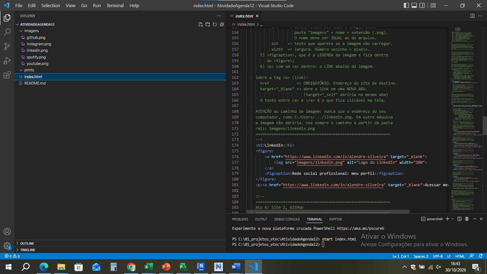
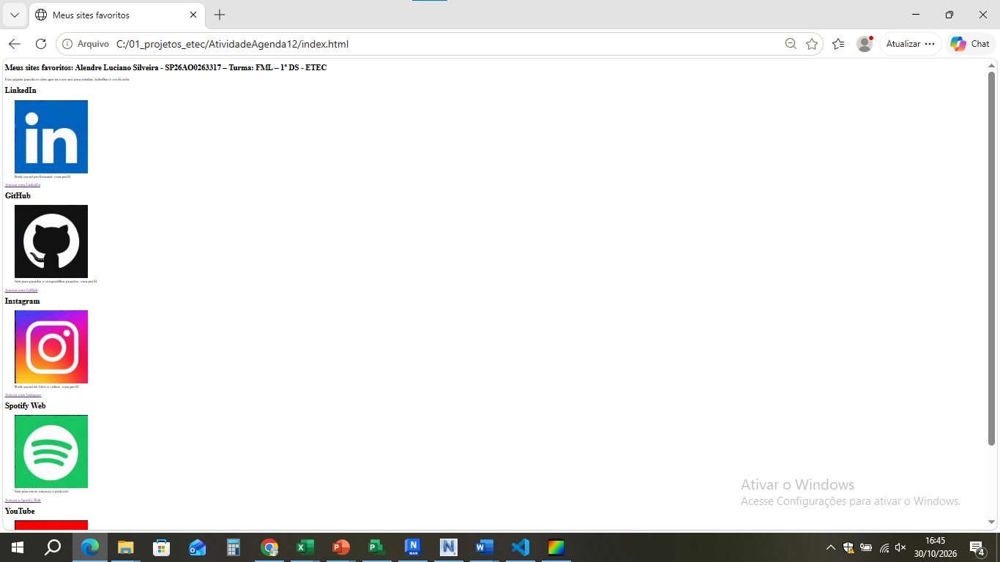

# 🌐 Meus Sites Favoritos

Página web feita em **HTML5** para guardar os meus sites favoritos, com o nome de cada site, a imagem (logotipo) e o link para acessar.

## 👤 Autor

| | |
|---|---|
| **Nome** | Alendre Luciano Silveira |
| **RM** | SP26AO0263317 |
| **Turma** | FML – 1º DS |
| **Curso** | Técnico em Desenvolvimento de Sistemas – ETEC |
| **Atividade** | Agenda 12 – HTML5: Vamos Programar! |

## 🎯 Objetivo da atividade

Desenvolver uma página web para guardar os sites favoritos, contendo:

- no título da aba: **Meus sites favoritos**;
- no título do corpo da página: **Meus sites favoritos** com o nome do aluno;
- **5 imagens** de sites favoritos;
- o **nome do site acima** de cada imagem;
- o **link para o site abaixo** de cada imagem;
- opcional: a **imagem também funcionando como link**.

## ⭐ Sites escolhidos

| Site | Link |
|---|---|
| LinkedIn | https://www.linkedin.com/in/alendre-silveira |
| GitHub | https://github.com/alendre-sjc |
| Instagram | https://www.instagram.com/alendre.silveira |
| Spotify Web | https://open.spotify.com/intl-pt |
| YouTube | https://www.youtube.com |

## 📁 Estrutura do projeto

```
AtividadeAgenda12/
 |-- index.html        => página principal (código comentado Ato por Ato)
 |-- README.md         => este arquivo de descrição
 |-- imagens/          => imagens usadas na página
 |    |-- linkedin.png
 |    |-- github.png
 |    |-- instagram.png
 |    |-- spotify.png
 |    '-- youtube.png
 '-- prints/           => capturas de tela da entrega
      |-- print-codigo.png
      '-- print-navegador.png
```

## 🏷️ Tags e atributos utilizados

| Tag | Para que serve | Atributos usados |
|---|---|---|
| `<!DOCTYPE html>` | Informa que a página usa HTML5 | — |
| `<html>` | Abre e fecha toda a página | `lang="pt-BR"` |
| `<head>` | Cabeçalho com as configurações da página | — |
| `<meta>` | Informações sobre a página (metadados) | `charset`, `http-equiv`, `name="viewport"` |
| `<title>` | Título exibido na aba do navegador | — |
| `<body>` | Corpo: tudo que aparece na tela | — |
| `<h1>` | Título principal e nome de cada site | — |
| `<p>` | Parágrafo de texto | — |
| `<figure>` | Área reservada para a imagem | — |
| `` | Mostra a imagem na página | `src`, `alt`, `width` |
| `<figcaption>` | Legenda da imagem | — |
| `<a>` | Cria o link para outro site | `href`, `target="_blank"` |
| `<!-- -->` | Comentário (não aparece na página) | — |

## ▶️ Como executar

1. Baixe ou clone este repositório.
2. Abra a pasta do projeto.
3. Dê dois cliques no arquivo `index.html` e a página abrirá no navegador.

Pelo terminal do VS Code, dentro da pasta do projeto:

```
start index.html
```

## 🖼️ Capturas de tela

### Código no VS Code


### Página no navegador


## 📌 Fonte das imagens

Logotipos retirados dos próprios sites citados, usados apenas para fins de estudo.

## 🛠️ Ferramentas utilizadas

- **HTML5**
- **Visual Studio Code**
- **Google Chrome**
- **Git e GitHub**
